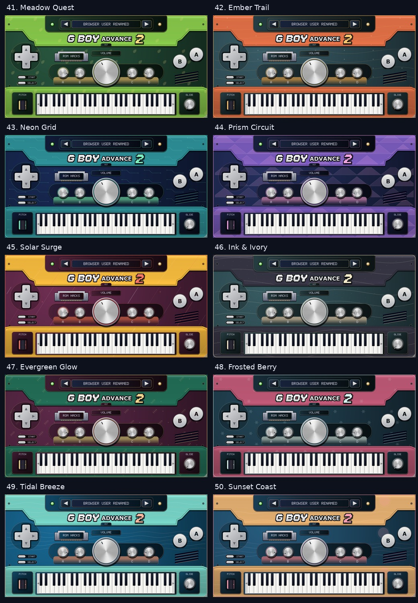

# G BOY ADVANCE 2 — 0.19.3

CPU optimization build: faster exact phase wrapping and wavetable indexing, and paired stereo saturation FIR processing. No factory sound, voice budget, release time, oscillator partial, modulation rate or effect is reduced. [Changes and validation](docs/RELEASE_0_19_3.md). Windows builds, all suites, both plugin validators and installer lifecycle tests passed. Simple SoundFont workloads measured about 4–5% less CPU; layered banks improved less. Built-in pad/string gains on Windows were minimal, so that remains further work. The 50% target remains unmet.

## Appearance and compatibility

**50 UI skins**, including ten original themed finishes: Meadow Quest, Ember Trail, Neon Grid, Prism Circuit, Solar Surge, Ink & Ivory, Evergreen Glow, Frosted Berry, Tidal Breeze and Sunset Coast. Nature/adventure, digital fantasy, anime energy, classic cartoon, Christmas and beach directions use original palettes and vector decorations.

SELECT → SKIN selects an appearance. NEW COLOUR ON LOAD includes all 50 skins; disable it for a fixed project color. Existing skins, saved projects, user presets and SoundFont libraries are preserved. All 654 factory parameter sets are retained.

[Earlier appearance update](docs/RELEASE_0_19_2.md) · [Source branch](https://github.com/treezysosa/G-Boy-Advance-2/tree/feature/pad-string-performance-0193). The 0.19.2 Windows x64 compilation, 50-skin state/render checks, pluginval strictness 10 and Steinberg validator passed. The installer passed the 0.19.1 upgrade, reinstall, launch and uninstall checks with user data preserved. Pattern artwork uses the existing static UI cache. Prepared binaries are unsigned; the owner deferred licensing.



Native Windows JUCE component renders of the ten added skins. All 50 main/advanced appearances and project-state roundtrips passed. The ten new themes also have browser and 150% density captures. The ROM Hacks cartridge stays beside the volume knob.

## Build on Windows

Install Visual Studio 2022 with **Desktop development with C++**, a Windows SDK, CMake 3.24+, and Git. In PowerShell:

```powershell
git clone --branch feature/pad-string-performance-0193 https://github.com/treezysosa/G-Boy-Advance-2.git
cd G-Boy-Advance-2
powershell -ExecutionPolicy Bypass -File scripts/build-windows.ps1
```

You can also use [Build and validate in GitHub Actions](https://github.com/treezysosa/G-Boy-Advance-2/actions?query=branch%3Afeature%2Fpad-string-performance-0193). Factory/vocal and retro audition files are separate test outputs and are never installed or loaded by the instrument.

The first local build downloads the pinned JUCE 8.0.6 source. For an offline build, supply an existing checkout:

```powershell
cmake -S . -B build -G "Visual Studio 17 2022" -A x64 -DGBA_JUCE_PATH=C:/SDKs/JUCE-8.0.6
cmake --build build --config Release --parallel 2
ctest --test-dir build -C Release --output-on-failure
# Optional host validation (downloads the build-time pluginval tool):
powershell -ExecutionPolicy Bypass -File scripts/validate-windows.ps1
```

Additional Phase 10 checks (official SDK is a separate build-time tool):

```powershell
git clone --branch v3.7.12_build_20 --recurse-submodules https://github.com/steinbergmedia/vst3sdk.git Dependencies/vst3sdk
powershell -ExecutionPolicy Bypass -File scripts/validate-steinberg-windows.ps1
cmake -S . -B build -DGBA_BUILD_BENCHMARKS=ON
cmake --build build --config Release --target gba2-benchmark
./build/Release/gba2-benchmark.exe build/validation-logs/callback-profile.csv
powershell -ExecutionPolicy Bypass -File scripts/package-windows.ps1 -Iscc 'C:/Program Files (x86)/Inno Setup 6/ISCC.exe'
# Clean disposable admin VM only; refuses existing product installations:
powershell -ExecutionPolicy Bypass -File scripts/test-installer-windows.ps1
```

The installer acceptance script uses the actual common VST3 folder and removes its test installation. Review the pending manual gates in [RELEASE_CHECKLIST.md](docs/RELEASE_CHECKLIST.md).

Output:

- `build/GBoyAdvance2_artefacts/Release/VST3/G Boy Advance 2.vst3/` (copy the entire bundle)
- `build/GBoyAdvance2_artefacts/Release/Standalone/G Boy Advance 2.exe`

Close your DAW, copy the entire `.vst3` directory into `C:\Program Files\Common Files\VST3\`, reopen the DAW, and rescan plugins. The standalone requires selecting a working audio device and MIDI input in its settings. Manual tests in FL Studio, Ableton Live, REAPER, Cubase, and Studio One are pending.

## Implemented in source

- Eight engines: subtractive, FM, additive, mipmapped original wavetables, Karplus–Strong plucked strings, formant vocals, chiptune, and modal keys.
- Sine, harmonic-limited triangle, PolyBLEP saw / square / pulse, and noise; resonant low-pass, high-pass, band-pass, notch, and formant filters.
- Two ADSRs, two routable LFOs, vibrato, tremolo, velocity, 16-channel MIDI pitch bend / modulation / sustain, 1–32 voices, stealing, mono / legato, glide.
- Reverb, delay, chorus, phaser, flanger, saturation, distortion, bitcrusher, tape wow / flutter, low / high shelves, and stereo width.
- 654 factory patches across 20 categories, explicit named-instrument, vocal and retro profiles, calibrated levels and stable program identities. Vocal patches are synthesized vowel-like timbres and contain no recorded voices or speech.
- Reference-based vector UI, playable keyboard, spring-return pitch wheel, functional D-pad, preview A / stop B, START browser, SELECT advanced editor, assignable A–D controls.
- Fifty colour skins with nonrepeating launch colours or a fixed project choice; SoundFont drag and drop; host-visible parameters, project state, user preset Save As / import / export / rename / delete, favorites / recent patches, category search, tags, keyboard navigation.
- Windows CI, portable packaging and Inno Setup installer script, DSP and JUCE integration tests.

## Offline preset listening review

All 654 current sounds have complete 20-second audition renders and EBU R128 measurements. Human listening and any resulting sound changes remain pending; the installed factory bank is unchanged. The optional native renderer, offline A/B player and feedback export/import are documented in [PRESET_LISTENING.md](docs/PRESET_LISTENING.md).

## Factory and user presets

Canonical library: [`Presets/factory.json`](Presets/factory.json). The compiled plugin embeds the same parameter values in `Source/FactoryData.h`; users do not need to install an external bank. Regenerate both with `python scripts/generate_presets.py`. Recipe changes require the offline calibration workflow in the preset-format document; no authoring files or audio renders are needed at runtime.

User patches: `%APPDATA%\Treezy Audio\G Boy Advance 2\Presets\*.gba2preset`. Favorites and recents: `library.json` in the parent directory. Every .gba2preset synthesis patch contains parameters and metadata only. SoundFont banks are imported separately through ROM Hacks. Use START → IMPORT to add external `.gba2preset` patches and EXPORT SOUND to share the current edited sound. Maize `.mse` banks are unsupported; only `.sf2` banks are supported in ROM Hacks; `.chl` support needs an identified source format and is not implemented. See [preset schema](docs/PRESET_FORMAT.md).

## Tests without JUCE

```sh
cmake -S . -B build-core -DGBA_BUILD_PLUGIN=OFF -DCMAKE_BUILD_TYPE=Release
cmake --build build-core --parallel 2
ctest --test-dir build-core --output-on-failure
```

Or, run all seven DSP suites with a C++20 compiler alone:

```sh
bash scripts/test-core.sh
```

To compile the original factory/effects suite separately:

```sh
mkdir -p build-core
g++ -std=c++20 -O2 -Wall -Wextra -Wpedantic -Werror -ISource Source/dsp/SynthEngine.cpp Source/dsp/Effects.cpp Tests/EngineTests.cpp Tests/AllocationTracker.cpp -o build-core/gba2-tests
cd build-core
./gba2-tests --render
```

`--render` optionally creates six synthesized demonstration WAVs as test output. These are never used by the instrument. Every test run writes `preset-validation.csv` with factory patch RMS / peak levels.

See [performance measurements](docs/PERFORMANCE.md) for the additive-engine optimization and the optional benchmark target.

## Packaging and licensing

`python scripts/package-source.py` creates a complete source ZIP and checks that the Windows build script and GitHub workflow are included.

With Inno Setup 6 installed, run `scripts/package-windows.ps1` after a successful release build. This creates an unsigned Windows archive and installer under `dist/`. Windows builds, pluginval strictness 10, the separate Steinberg VST3 validator and automated installer lifecycle checks passed. Release signing, listening review, interactive installer/device checks and actual DAW acceptance remain owner release checks. This preparation does not decide the deferred licensing terms.

Engine 6 has a revised sound in 0.8.0, including existing chiptune patches; the Phase 7 formant revision remains. Saved parameters retain their IDs, but audio renders may differ.

Read [third-party and licensing notes](docs/LICENSING.md) before distribution. JUCE 8 is dual licensed under AGPLv3 and commercial terms; source availability by itself does not fulfill all license obligations. No Nintendo branding or artwork is bundled.

[User manual](docs/USER_MANUAL.md) · [DSP design](docs/ARCHITECTURE.md) · [Validation](docs/VALIDATION.md) · [Remaining work](docs/NEXT_STEPS.md)
