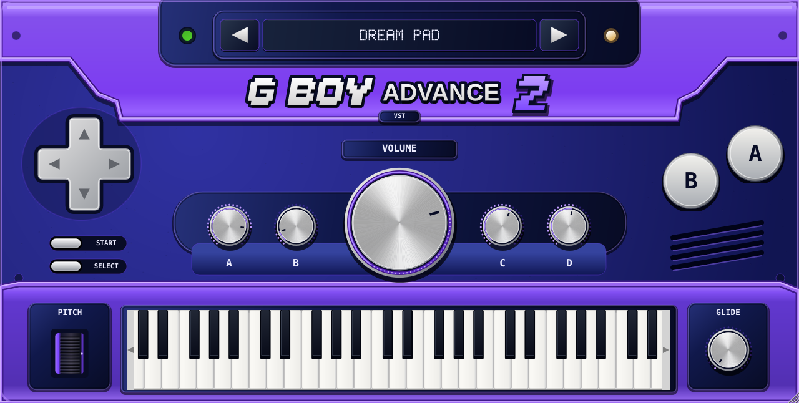

# G BOY ADVANCE 2

A C++20 / JUCE 8 hybrid synthesis instrument targeting Windows x64 VST3 and standalone. The purple, wide console interface uses native scalable controls. All sound is generated mathematically: there is no sampler, sample import, commercial game audio, or network dependency at runtime.

**Development build 0.2.0 — Phase 2 UI refinement.** The synthesis foundation already passed Windows builds and pluginval strictness 10 in version 0.1.1. This revision adds closer reference typography, inset casing details, a dotted master LED ring, shaped control hit areas, shaded playable keys and keyboard-focus fixes. The updated local JUCE integration suite passes 171 checks. Windows compilation, the additional native-window piano mouse test and pluginval are being rerun for this revision; see [Phase 2 progress](docs/PHASE_2.md) and [validation](docs/VALIDATION.md).



Actual Phase 2 JUCE software render at 1280×646 from the Linux integration executable. All controls are native components with vector painting; no reference bitmap is used. Interactive Windows high-DPI and DAW testing remain pending.

## Build on Windows

Install Visual Studio 2022 with **Desktop development with C++**, a Windows SDK, CMake 3.24+, and Git. In PowerShell:

```powershell
git clone https://github.com/treezysosa/G-Boy-Advance-2.git
cd G-Boy-Advance-2
powershell -ExecutionPolicy Bypass -File scripts/build-windows.ps1
```

You can also open [Build and validate in GitHub Actions](https://github.com/treezysosa/G-Boy-Advance-2/actions/workflows/build.yml), choose **Run workflow**, and download the Windows artifact after the job succeeds. The workflow and Windows script are included in the corrected source upload. Windows compilation, both test suites, pluginval at strictness 10, and packaging all pass in [run 39004957883](https://github.com/treezysosa/G-Boy-Advance-2/actions/runs/39004957883).

The first local build downloads the pinned JUCE 8.0.6 source. For an offline build, supply an existing checkout:

```powershell
cmake -S . -B build -G "Visual Studio 17 2022" -A x64 -DGBA_JUCE_PATH=C:/SDKs/JUCE-8.0.6
cmake --build build --config Release --parallel 2
ctest --test-dir build -C Release --output-on-failure
# Optional host validation (downloads the build-time pluginval tool):
powershell -ExecutionPolicy Bypass -File scripts/validate-windows.ps1
```

Output:

- `build/GBoyAdvance2_artefacts/Release/VST3/G Boy Advance 2.vst3/` (copy the entire bundle)
- `build/GBoyAdvance2_artefacts/Release/Standalone/G Boy Advance 2.exe`

Close your DAW, copy the entire `.vst3` directory into `C:\Program Files\Common Files\VST3\`, reopen the DAW, and rescan plugins. The standalone requires selecting a working audio device and MIDI input in its settings. Manual tests in FL Studio, Ableton Live, REAPER, Cubase, and Studio One are pending.

## Implemented in source

- Eight engines: subtractive, FM, additive, mipmapped original wavetables, Karplus–Strong plucked strings, formant vocals, chiptune, and modal keys.
- Sine, harmonic-limited triangle, PolyBLEP saw / square / pulse, and noise; resonant low-pass, high-pass, band-pass, notch, and formant filters.
- Two ADSRs, two routable LFOs, vibrato, tremolo, velocity, 16-channel MIDI pitch bend / modulation / sustain, 1–32 voices, stealing, mono / legato, glide.
- Reverb, delay, chorus, phaser, flanger, saturation, distortion, bitcrusher, tape wow / flutter, low / high shelves, and stereo width.
- 382 original factory patches across 17 categories. Vocal patches are synthesized vowel-like timbres and contain no recorded voices or speech.
- Reference-based vector UI, playable keyboard, spring-return pitch wheel, functional D-pad, preview A / stop B, START browser, SELECT advanced editor, assignable A–D controls.
- Host-visible parameters, project state, user preset Save As / rename / delete, favorites / recent patches, category search, tags, keyboard navigation.
- Windows CI, portable packaging and Inno Setup installer script, DSP and JUCE integration tests.

## Factory and user presets

Canonical library: [`Presets/factory.json`](Presets/factory.json). The compiled plugin embeds the same parameter values in `Source/FactoryData.h`; users do not need to install an external bank. Regenerate both with `python scripts/generate_presets.py`.

User patches: `%APPDATA%\Treezy Audio\G Boy Advance 2\Presets\*.gba2preset`. Favorites and recents: `library.json` in the parent directory. Every patch contains parameters and metadata only. See [preset schema](docs/PRESET_FORMAT.md).

## Tests without JUCE

```sh
cmake -S . -B build-core -DGBA_BUILD_PLUGIN=OFF -DCMAKE_BUILD_TYPE=Release
cmake --build build-core --parallel 2
ctest --test-dir build-core --output-on-failure
```

Or, with a C++20 compiler alone:

```sh
mkdir -p build-core
g++ -std=c++20 -O2 -Wall -Wextra -Wpedantic -Werror -ISource Source/dsp/SynthEngine.cpp Tests/EngineTests.cpp Tests/AllocationTracker.cpp -o build-core/gba2-tests
cd build-core
./gba2-tests --render
```

`--render` optionally creates six synthesized demonstration WAVs as test output. These are never used by the instrument. Every test run writes `preset-validation.csv` with factory patch RMS / peak levels.

See [performance measurements](docs/PERFORMANCE.md) for the additive-engine optimization and the optional benchmark target.

## Packaging and licensing

`python scripts/package-source.py` creates a complete source ZIP and checks that the Windows build script and GitHub workflow are included.

With Inno Setup 6 installed, run `scripts/package-windows.ps1` after a successful release build. This creates an unsigned Windows archive and installer under `dist/`. Release signing, listening review, the separate Steinberg VST3 validator, interactive installer checks, and DAW testing remain release gates. Pluginval strictness 10 has passed on Windows.

Read [third-party and licensing notes](docs/LICENSING.md) before distribution. JUCE 8 is dual licensed under AGPLv3 and commercial terms; source availability by itself does not fulfill all license obligations. No Nintendo branding or artwork is bundled.

[User manual](docs/USER_MANUAL.md) · [DSP design](docs/ARCHITECTURE.md) · [Validation](docs/VALIDATION.md) · [Remaining work](docs/NEXT_STEPS.md)
