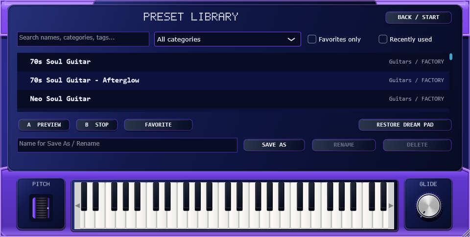
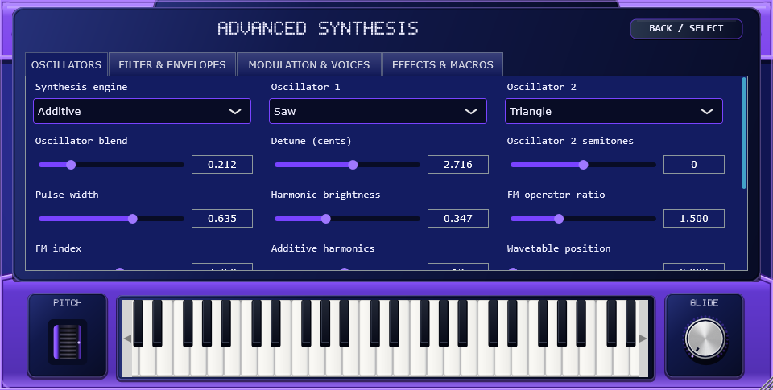

# Phase 2 — approved interface

Development revision 0.2.0. This phase builds on the working VST3 foundation; it does not replace the synthesizer with a visual prototype.

## Implemented

- Wide 1280×646 reference layout, resizing from approximately 960 to 1920 pixels without moving the selected piano octave.
- Deep indigo main body, layered purple casing bevels, inset panels, moulded-plastic detail and rounded speaker slots. All artwork is generated with JUCE vector drawing.
- Original heavy slanted G BOY lettering, smaller ADVANCE lettering, purple 2, compact VST subtitle and white pixel LCD text sized to the reference. Front-panel captions and START/SELECT use original vector pixel lettering; text-heavy Windows panels select Consolas instead of the serif default monospace font.
- Silver volume/macro/glide knobs, full dotted purple master LED ring, spring-return ridged pitch wheel and shaded black/white piano keys.
- Native A/B buttons with circular hit areas, silver START/SELECT caps and visible keyboard-focus feedback.
- Four separate accessible D-pad buttons; blank corners and the neutral centre do not select patches. Arrow keys select patches/categories on the main page.
- Covered main controls cannot receive keyboard interaction while the preset browser or advanced panel is open. F1/F2 toggle their panels; Escape/BACK return immediately. Piano/pitch/glide remain usable.
- Stable macro names and destination descriptions; all four default mappings and reassignment are connected to actual synth parameters.
- Less UI repainting: the timer updates the output LED only when its state changes rather than repainting the whole editor every 40 ms.

## Actual component renders

These are actual component renders from the compiled Windows JUCE test executable, not generated mockups. The supplied reference image is not bundled or used as a background.

## Verification

- Strict C++20 compilation against JUCE 8.0.6: PASS on Linux.
- JUCE integration suite: 171 checks PASS on Linux.
- Snapshot coverage: 960/1280/1920 logical widths, main at 125%/150%/200% render scales, browser and advanced editor at minimum size.
- Windows x64 VST3/standalone build: PASS.
- Windows integration suite: 174 checks PASS, including native-window C4 mouse-down/audio delivery/mouse-up.
- Pluginval 1.0.4 strictness 10: SUCCESS.
- Portable ZIP and installer compilation: PASS. Interactive installation remains pending.
- [Windows CI run 39007537286](https://github.com/treezysosa/G-Boy-Advance-2/actions/runs/39007537286), source `5ed4948b2d182693f05a98d896cd92e59fd87f22`.

The final typography revision passes all checks above. The implementation is ready for visual and interactive acceptance; the checks below remain open.

## Remaining visual acceptance

Inspect the installed standalone and each target DAW at Windows 100%, 125%, 150% and 200% scaling, move between monitors, navigate all controls with Tab/Shift+Tab, test screen-reader names, and compare physical mouse/touch behavior with the reference. Automated snapshots cannot establish those interactive behaviors. The reference's photographic texture is approximated with scalable original vector graphics; exact raster reproduction is not claimed.
